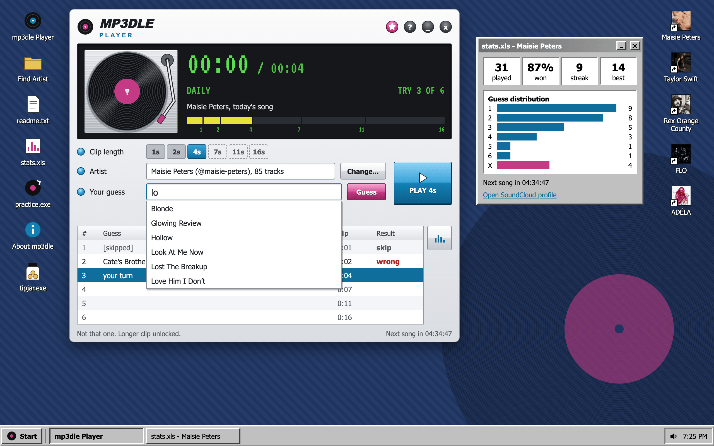
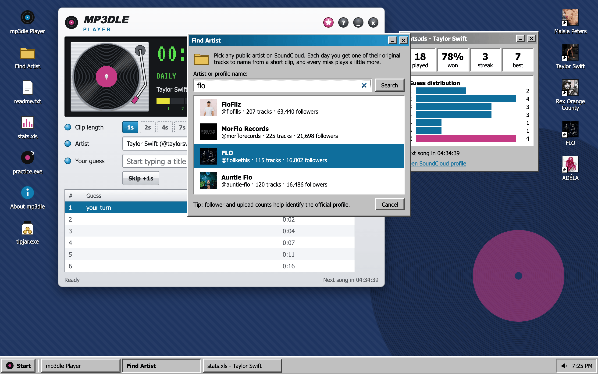
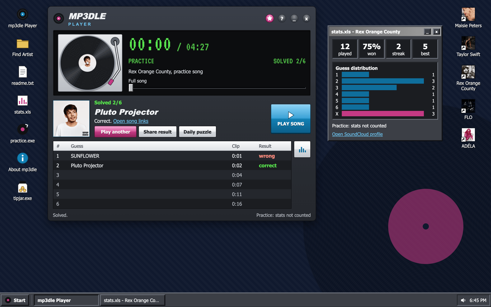
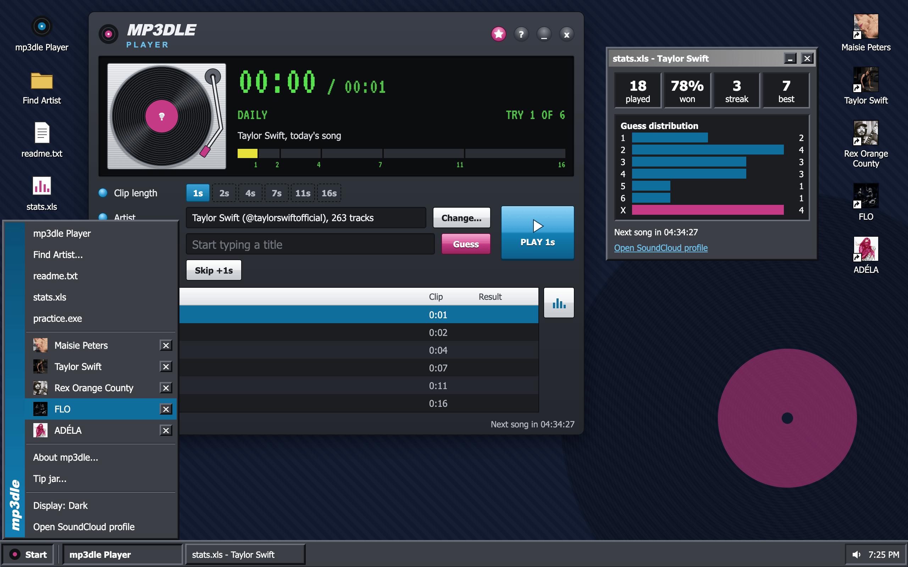
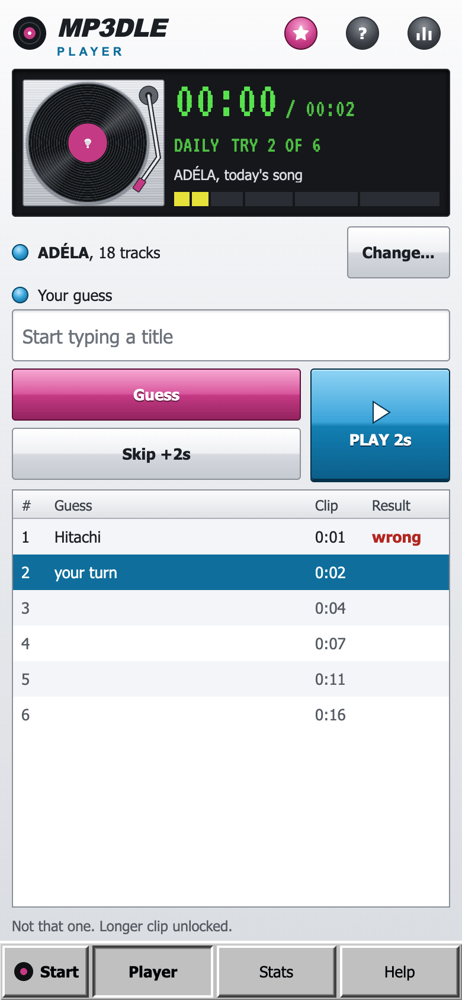
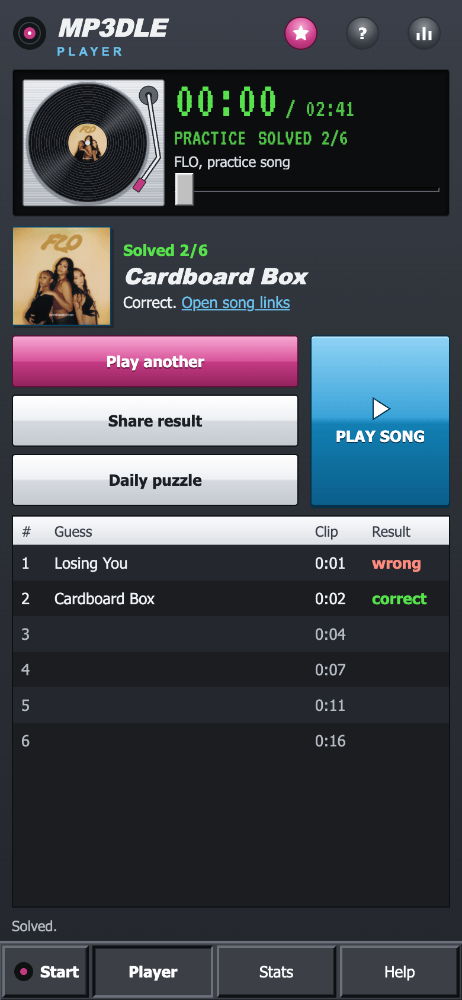

# mp3dle

A daily guess-the-song game for any SoundCloud artist. Search for a public artist, choose the
correct profile, and play a daily song drawn from that artist's cleaned public catalog. It looks like an old desktop:
the game is a player app in a window, with a Start menu, readme and stats. On phones the player
fills the screen.



## What it does

- Searches public SoundCloud artist profiles without requiring users to paste profile slugs.
- Shows usernames, profile handles, upload counts, follower counts, and avatars to disambiguate
  similarly named accounts.
- Imports every public, streamable track of at least 17 seconds from the selected profile.
- Removes tracks with bracketed qualifiers for alternate recordings, mixes, demos, live
  performances, commentary, interviews, previews, covers, and similar extras, including
  acoustic, instrumental, karaoke, sped-up, slowed, and remastered versions.
- Also removes tracks whose title suffix starts with labels such as acoustic, remix, edit,
  version, demo, live, mix, commentary, voice memo, track by track, or interview after a hyphen,
  en dash, em dash, or colon. `(Taylor's Version)` and `[Taylor's Version]` are ignored before
  filtering, so those re-recordings stay in.
- Collapses duplicate normalized titles and prefers a clean, unsuffixed SoundCloud slug.
- Also drops bracketed or dashed variants when the plain title is present,
  such as `Soft (Unlocked)` next to `Soft` (part numbers excepted), and live-session uploads
  such as COLORS shows and Tiny Desk.
- Offers another practice song after every completed round without changing the daily result,
  statistics, or streak.
- Lets you star artists to keep them on the desktop (or in the Start menu on a phone).
- Cycles Auto, Light, and Dark through the Start menu's Display item; Auto follows the system's
  light/dark setting.
- Keeps game progress, per-artist statistics, favorites, theme, and volume in the browser only.
- Uses SoundCloud's official widget for playback.

## Screenshots

Track and follower counts distinguish FLO (@flolikethis) from FloFilz, MorFlo Records and Auntie Flo in a search for "flo".



Rex Orange County's "Pluto Projector" is solved on the second try in a dark-mode practice round that does not count toward stats.



The Start menu lists Maisie Peters, Taylor Swift, Rex Orange County, FLO and ADÉLA with remove buttons, plus the Display setting.



The phone player fills the screen, with ADÉLA's daily round on the left and a solved FLO practice round on the right.

<p> </p>

## Privacy and limitations

This app has no accounts, analytics, advertising identifiers, or application database. Netlify
serves and temporarily caches the search/catalog API responses. The browser contacts SoundCloud
through the app's server routes for artist metadata and through the SoundCloud widget for audio.

The credential-free discovery path reads the temporary web client identifier present in
SoundCloud's public pages. That interface is not a documented public API contract and may change.
Failures are returned visibly; the app never replaces a catalog with malformed or empty data.

Only tracks uploaded by the selected profile are included. Reposts, likes, playlists, private
tracks, blocked tracks, and clips shorter than 17 seconds are excluded.

## Run locally

Requirements: Node.js 24+ (see `.nvmrc`) and npm 10+.

```bash
npm install
npm run dev -- --open
```

## Validate

```bash
npm run check
npm run lint
npm test
npm run build
```

## Deploy to Netlify

Connect the repository to Netlify and deploy. `netlify.toml` supplies the build command and the
SvelteKit Netlify adapter creates the API functions automatically. No SoundCloud API key or
environment variables are required.

## Catalog filtering

The shared rules live in `src/lib/tracks.ts`. To support project-specific curation later, add or
remove qualifier terms in `ALTERNATE_VERSION`. Parenthetical collaborations such as
`(feat. Artist)` are retained, and ordinary song titles such as `Live Forever` are not treated as
alternate versions.

## Structure

```text
src/lib/Mp3dleGame.svelte          The player: daily and practice rounds, playback, sharing
src/lib/retro/Desktop.svelte        Desktop, windows, taskbar, Start menu and favorites
src/lib/retro/FindArtist.svelte     Artist search and profile selection
src/lib/retro/                      The other windows and shared widgets
src/lib/game-state.ts               Saved games and stats
src/lib/server/soundcloud.ts        Public artist search and catalog import
src/lib/tracks.ts                   Catalog filtering and daily selection
src/routes/api/soundcloud/artists   Artist search endpoint
src/routes/api/soundcloud/catalog   Per-artist catalog endpoint
```

Licensed under GPL-3.0.
